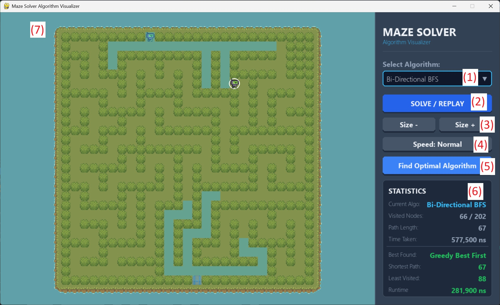

# Maze Solver Visualizer

Interactive Python maze generator and visualizer for comparing classic search, pathfinding, and agent-based maze-solving algorithms.

The project generates a new maze, renders it with a sprite-based Pygame interface, animates each algorithm as it explores the maze, and reports comparative statistics such as visited nodes, path length, and runtime.



## What It Does

- Generates random mazes using a depth-first maze generator
- Visualizes the maze with tile-based graphics in Pygame
- Animates algorithm exploration and final solution path
- Compares algorithms by:
  - path length
  - visited nodes
  - runtime
- Lets you resize the maze and replay algorithms on the current layout
- Finds the best algorithm for the current maze using the project’s comparison rules

## Implemented Algorithms

Global search and pathfinding:
- `BFS`
- `DFS`
- `Bi-Directional BFS`
- `Dijkstra`
- `A* Search`
- `Greedy Best First`
- `Jump Point Search`
- `IDA* Search`
- `Lee Algorithm`
- `Dead-End Filling`

Agent-based maze solvers:
- `Wall Follower`
- `Pledge Algorithm`
- `Trémaux`

## Project Structure

- [app.py](/Users/omarramadan/Desktop/Western_Stuff/2025-26/CS3346%20-%20intro%20AI/project/CS3346-Project/app.py)
  Main Pygame application and visualizer.
- [maze_generator/maze_generator.py](/Users/omarramadan/Desktop/Western_Stuff/2025-26/CS3346%20-%20intro%20AI/project/CS3346-Project/maze_generator/maze_generator.py)
  Maze generation logic, including optional seeded generation.
- [maze_solver/baseline.py](/Users/omarramadan/Desktop/Western_Stuff/2025-26/CS3346%20-%20intro%20AI/project/CS3346-Project/maze_solver/baseline.py)
  Graph-search and pathfinding algorithms.
- [maze_solver/agent.py](/Users/omarramadan/Desktop/Western_Stuff/2025-26/CS3346%20-%20intro%20AI/project/CS3346-Project/maze_solver/agent.py)
  Agent-style maze-solving algorithms.
- [maze_solver/utils.py](/Users/omarramadan/Desktop/Western_Stuff/2025-26/CS3346%20-%20intro%20AI/project/CS3346-Project/maze_solver/utils.py)
  Maze parsing helpers such as extracting start and goal markers.
- `assets/`
  Tiles, robot sprite, and README preview image.

## Maze Representation

The visualizer and solvers use a 2D array where:

- `1` = wall
- `0` = open path
- `2` = goal
- `3` = player start

Example:

```python
[
    [1, 1, 1, 1, 1],
    [3, 0, 0, 0, 2],
    [1, 1, 1, 0, 1],
    [1, 0, 0, 0, 1],
    [1, 1, 1, 1, 1],
]
```

## Setup

Create a virtual environment and install dependencies.

macOS / Linux:

```bash
python3 -m venv venv
venv/bin/pip install -r requirements.txt
```

Windows:

```bash
python -m venv venv
venv\Scripts\pip install -r requirements.txt
```

## Run the Project

Start the visualizer with:

```bash
venv/bin/python app.py
```

On Windows:

```bash
venv\Scripts\python app.py
```

## How to Use the Visualizer

1. Select an algorithm from the dropdown.
2. Click `SOLVE / REPLAY` to animate the selected algorithm.
3. Use `Size +` or `Size -` to regenerate the maze at a different size.
4. Use the speed button to switch between normal, fast, and slow animation.
5. Click `Find Optimal Algorithm` to automatically select the best solver for the current maze.
6. Watch the maze area animate explored nodes and the final solution path.
7. Read the sidebar statistics for current and best-found results.

## Statistics Shown

For the currently selected algorithm:
- current algorithm name
- visited nodes
- path length
- runtime

For the best algorithm found so far on the current maze:
- best algorithm name
- shortest path
- least visited
- best runtime

## Notes

- Maze sizes are adjusted dynamically and the renderer rescales the board to fit the available view area.
- The generator supports a seed parameter for reproducible mazes.
- Agent-based algorithms are included for comparison, even though they behave differently from full-map graph search methods.
- `Jump Point Search`, `IDA*`, and `Lee Algorithm` are included as part of the algorithm comparison set.

## Testing

Run the test suite with:

```bash
venv/bin/python -m pytest
```

The repository includes tests for:
- baseline graph search
- advanced search algorithms
- agent-based algorithms
- dead-end filling
- instrumentation
- utility helpers

## Description

This project was built to explore how different AI search strategies behave on the same maze. Instead of only producing a final answer, it emphasizes visualization, comparison, and algorithm behavior, making it useful both as a course project and as a practical demonstration of pathfinding techniques.
